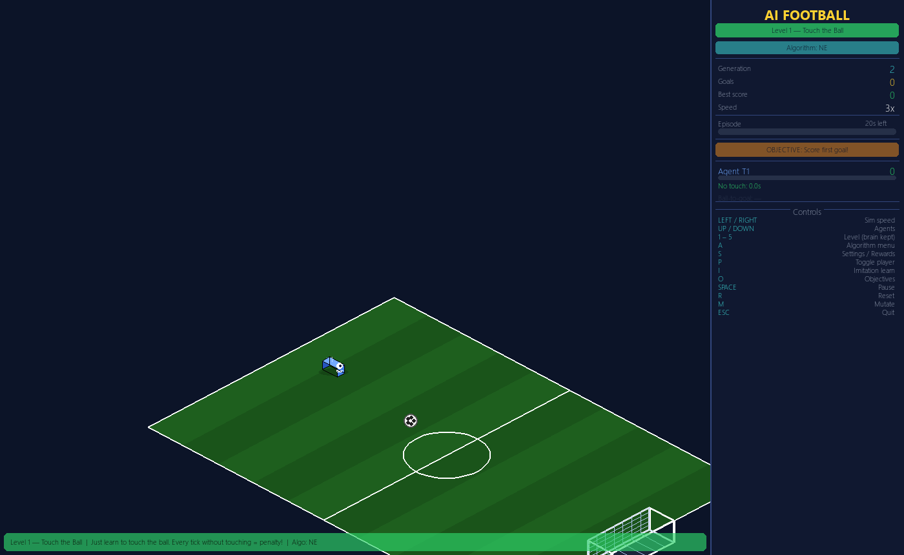

# AI Simulations

Small simulations where agents learn from scratch. They are built with `pygame` and `numpy`, with no machine learning framework.

[Türkçe](README.tr.md)



| File | What it does |
|---|---|
| `rl_football_sim.py` | Football agents with 5 levels, adjustable agent count and speed, and switchable learning algorithms including neuroevolution, PPO-Lite and DQN-Lite. Needs `config.py`. |
| `football_ai.py` | The earlier, simpler version of the football agents |
| `ai_boxing.py` | Two boxers learn with a PPO network. Each limb takes damage separately, with fatigue, blocks and knockouts. |
| `fish_evolution.py` | A school of fish hunted by a shark. Speed, vision and flocking genes change over generations. |
| `ai_football_3d.html` | A 3D football scene in the browser |

## Run

```
pip install pygame numpy
python ai_boxing.py
```
